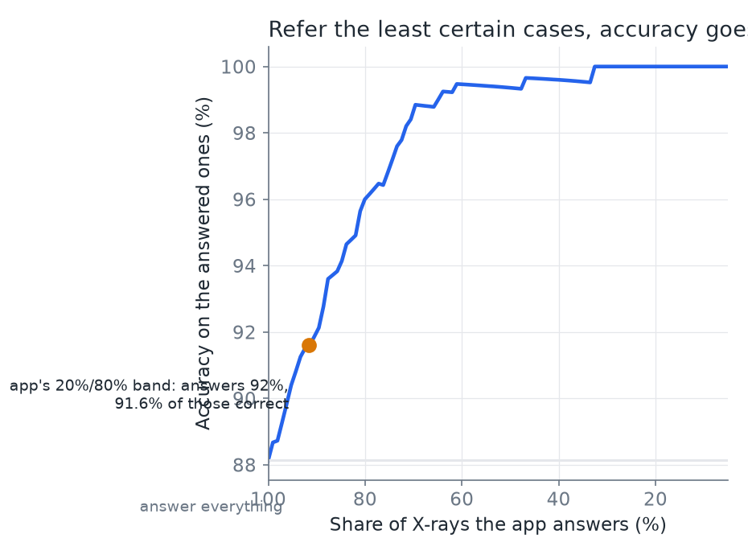
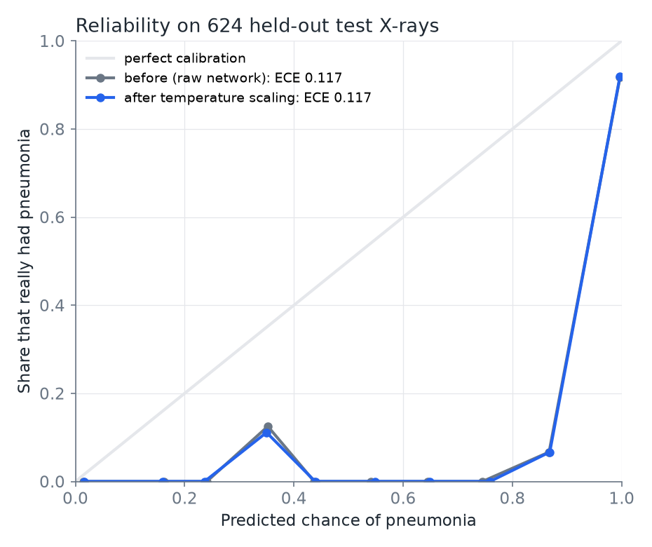
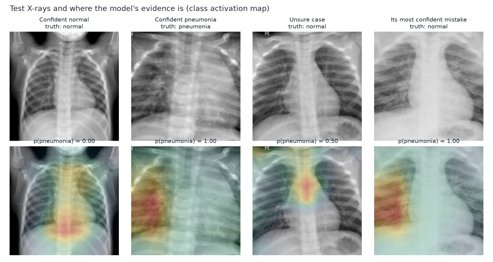

# X-Ray Triage, Calibrated

**Neural Storm 2026 · Track: Human Impact · Problem statement HI-01 (medical imaging)**

A pneumonia triage tool for pediatric chest X-rays that says *how sure it is* and refers the cases it
is unsure about to a radiologist, instead of guessing.

> **On 624 held-out pediatric chest X-rays, every one of its 135 "likely normal" answers was right.
> It never told a child with pneumonia that their film looked fine.** The cost: 48 of 234 healthy
> children were flagged "likely pneumonia", and 52 unclear films (8%) were sent to a radiologist.
> Ranking quality: test AUROC **0.991** (95% CI 0.984–0.996).

**Live demo:** LIVE_LINK_TODO (no login needed) · **Model:** ResNet-18 fine-tuned, served with onnxruntime on CPU, 23 ms per image

> ⚠️ Research demo, **not a medical device**. Trained on one public pediatric dataset; never use it to diagnose or rule out pneumonia.

---

## Team

- **Team name:** Joshua Yeung (solo entry)
- **Members:** Joshua Yeung

## Problem

Pneumonia is a leading cause of death in young children, and the chest X-ray is the standard first
test. Where radiologists are scarce, films wait. A model that flags likely pneumonia can help sort
that queue, but only if it is honest about its limits: a confident wrong "normal" sends a sick child
home, and a classifier that outputs 0.99 for everything gives a clinician nothing to work with.

Most pneumonia classifiers report accuracy and stop. This project asks three further questions:

1. **Are the probabilities true?** When it says 80%, do about 80 in 100 such films show pneumonia? (*calibration*)
2. **Can it say "I don't know"?** Does refusing the unclear cases make the answers it does give safer? (*selective prediction*)
3. **Can a person check its reasoning?** Where on the film was the evidence? (*class activation maps*)

## Solution

Upload a chest X-ray (or pick one of seven test images) and the app returns:

- a **calibrated probability** of pneumonia,
- one of three **triage bands**, fixed in advance: **likely normal** (p ≤ 20%), **likely pneumonia** (p ≥ 80%), or **unsure: refer to a radiologist** (in between),
- a **heatmap** of where on the film the evidence for its call sits,
- a "How reliable is it?" tab with the reliability diagram and coverage curve below, and a plain "Limits" tab.

### How it works

```
pneumoniamnist_128.npz  (4,708 train / 524 val / 624 test, 128 x 128 grayscale)
        │
        ▼
ResNet-18, ImageNet weights ──► fine-tuned end to end (3 seeds, best epoch by val NLL)
   input upsampled to 224 px          augmentation: rotate ±10°, scale ±10%, shift ±6%,
   inside the model graph             brightness/contrast; no left-right flips (the heart is on the left)
        │
        ├─ baseline for comparison: frozen ImageNet features + L2 logistic regression
        ▼
temperature scaling fitted on validation  ──► calibrated p(pneumonia)
        │
        ▼
triage band 20% / 80% (set before testing) ──► likely normal / unsure, refer / likely pneumonia
        │
        ▼
test set scored once (protocol committed before any test number existed: scripts/evaluate.py)
        │
        ▼
ONNX export (44.7 MB) ── checked against PyTorch on all 624 test images (max logit gap 6.5e-5)
        │
        ▼
Streamlit app: onnxruntime on CPU, no PyTorch in the deployed app
```

**Heatmaps without autograd.** The network ends in global average pooling and one linear unit, so
Grad-CAM for the pneumonia logit reduces exactly to the class activation map
`cam = Σ_k w_k · A_k` (the gradient of the logit with respect to each feature map is the constant
`w_k / 49`). The exported model returns this 7 × 7 map next to the logit, which lets the app draw
heatmaps with onnxruntime alone. For a "likely normal" call the app shows the evidence *against*
pneumonia (`ReLU(−cam)`).

## Model performance (held-out test set, 624 images)

Test split: 390 pneumonia, 234 normal (always guessing "pneumonia" scores 62.5%). Shipped model:
fine-tune seed 2, chosen on validation. 95% intervals are percentile bootstraps over test images
(2,000 resamples). Source: [`artifacts/metrics.json`](artifacts/metrics.json).

| Metric | Value | 95% CI |
|---|---|---|
| AUROC | **0.991** | 0.984–0.996 |
| Accuracy at p = 0.5 | 88.1% | 85.6–90.5% |
| Sensitivity at p = 0.5 | 99.7% (389 / 390) | |
| Specificity at p = 0.5 | 68.8% (161 / 234) | |
| F1 | 0.913 | |
| Brier score | 0.092 | 0.074–0.112 |
| Expected calibration error (10 bins) | 0.117 | 0.096–0.139 |
| CPU latency per image (onnxruntime, 2 threads) | 23 ms median | |

### Triage bands (the part the app shows)

| Band | Films | Correct |
|---|---|---|
| Likely normal (p ≤ 0.20) | 135 | **135 (100%)**, no pneumonia missed |
| Likely pneumonia (p ≥ 0.80) | 437 | 389 (89.0%); 48 healthy children flagged |
| Unsure, refer (in between) | 52 | sent to a radiologist (51 normal, 1 pneumonia) |
| **Answered** | **572 of 624 (91.7%, CI 89.3–93.8%)** | **91.6% (CI 89.3–93.8%)** |

Of the 74 films the model gets wrong at a plain 50% cut-off, the band sends 26 to a radiologist
instead. The other 48 are confident false alarms on healthy films. In a triage setting that is
the cheaper mistake (a second read, not a missed infection), but it is the main weakness.



### Calibration: what held and what didn't



Temperature scaling was fitted on validation, where the model already looked almost perfect
(validation accuracy 98.7%, ECE 0.011, fitted temperature 1.03), so it had nothing to correct. On
the test split the model is **overconfident toward pneumonia**: films it scores above 0.8 are
pneumonia 89% of the time, not 99%. Test ECE is 0.117 before and after scaling.

The reason is a distribution shift built into the dataset. MedMNIST's own description: "We split
the source training set with a ratio of 9:1 into training and validation set and use its source
validation set as the test set." Validation is a slice of the training pool; test is a separate
split with a different mix (62.5% pneumonia vs 74.2% in validation). A model calibrated on an easy,
same-source validation set will not stay calibrated on a shifted test set, and this one did not.
I report that instead of tuning on the test set after the fact.

Two more results in the same vein, both reported as measured:

- The threshold that gave 90% specificity on validation gave **54.7%** specificity on test (sensitivity 100%).
- Picking the seed by validation chose the seed that was **worst** of three on test:

| Model | Val AUROC | Test AUROC | Test accuracy | Test ECE |
|---|---|---|---|---|
| Frozen ImageNet features + logistic regression | 0.996 | 0.981 | 88.9% | 0.111 |
| Fine-tune, seed 0 | 0.999 | 0.994 | 95.4% | 0.040 |
| Fine-tune, seed 1 | 0.998 | 0.994 | 94.4% | 0.059 |
| **Fine-tune, seed 2 (shipped, lowest val NLL)** | **0.999** | **0.991** | **88.1%** | **0.117** |

Fine-tuning beats the frozen baseline on ranking for every seed (test AUROC 0.993 ± 0.0015 vs 0.981),
while the seed-to-seed spread in specificity (68.8–88.9%) is far larger than validation could detect.

### Examples with heatmaps



## Screenshots

The figures above are rendered from the model's saved outputs. A screenshot of the live app goes here once it is deployed:

<!--  -->

## Limits

- **Not a medical device.** Not cleared, validated, or tested in any clinic.
- **One pediatric dataset.** PneumoniaMNIST is "based on a prior dataset of 5,856 pediatric chest X-Ray images" (MedMNIST). No adult films, other hospitals, other scanners, portable films, or lateral views.
- **128 × 128 pixels.** Fine detail a radiologist would use is gone.
- **Two classes.** Bacterial and viral pneumonia are lumped together; "normal" means labelled normal in this dataset. Nothing about effusion, tuberculosis, lines and tubes, or fractures.
- **Calibration did not transfer** to the shifted test split (above). Treat its probabilities as a ranking plus a rough guide, and expect false alarms on healthy films.
- **Heatmaps are hints, not explanations.** A 7 × 7 map shows which regions pushed the score; it can highlight text markers or borders, and a sensible-looking map does not make a prediction right.
- **Privacy.** The app processes an upload in memory for one prediction and does not store or log it.

## Tech stack

| Part | Tools |
|---|---|
| Training (Python) | PyTorch 2.14 (ResNet-18 written out in plain PyTorch, loading torchvision's ImageNet checkpoint), NumPy |
| Calibration, metrics, bootstrap | NumPy only (`src/triage/calibration.py`): temperature scaling, ECE, Brier, AUROC, selective prediction |
| Export and serving | ONNX (opset 17), onnxruntime 1.31 on CPU |
| App | Streamlit 1.66, Pillow |
| Figures | Matplotlib |
| Compute | One GPU job on a university Slurm cluster: 3 fine-tunes at ~60 s each on a Titan RTX |
| Tests | pytest (33 tests; the app is driven headlessly with `streamlit.testing`) |

## Setup and run locally

Python 3.11 or 3.12.

```bash
git clone https://github.com/JoshuaYeung-CS/xray-triage-calibrated.git
cd xray-triage-calibrated
python -m venv .venv && source .venv/bin/activate
pip install -r requirements.txt
streamlit run streamlit_app.py
```

The trained model (`artifacts/triage.onnx`) is in the repo, so the app runs without training anything.

Tests (no model is loaded; a stub session stands in for the network):

```bash
pip install -r requirements-dev.txt
pytest -q
```

### Reproduce the training and the numbers

```bash
# 1. Data and weights (CC BY 4.0 dataset; torchvision ImageNet weights)
mkdir -p data
curl -L -o data/pneumoniamnist_128.npz https://zenodo.org/api/records/10519652/files/pneumoniamnist_128.npz/content
curl -L -o data/resnet18-f37072fd.pth https://download.pytorch.org/models/resnet18-f37072fd.pth
# 2. Train, select, export (one GPU, about 10 minutes; see mind/job.sbatch for the Slurm wrapper)
pip install -r requirements-train.txt
python train/run.py --data data/pneumoniamnist_128.npz --weights data/resnet18-f37072fd.pth --out runs/full
# 3. Score validation and test once, then draw the figures
python scripts/evaluate.py runs/full
python scripts/make_figures.py data/pneumoniamnist_128.npz
```

## Repository map

| Path | What it is |
|---|---|
| `streamlit_app.py` | The app |
| `src/triage/` | Preprocessing, calibration and metrics, the ONNX predictor and heatmaps, a test stub |
| `train/` | ResNet-18 in plain PyTorch, the training/selection/export script |
| `scripts/evaluate.py` | The fixed evaluation protocol (test scored once) |
| `scripts/make_figures.py` | Figures and app examples from saved outputs |
| `artifacts/` | `triage.onnx`, `calibration.json`, `metrics.json` |
| `mind/job.sbatch` | The Slurm job that trained it |

## Hackathon requirements

| Required by the rules | Where |
|---|---|
| Project title and problem statement number | Top of this README (HI-01) |
| Team name and member names | [Team](#team) |
| Problem and solution | [Problem](#problem), [Solution](#solution) |
| Tech stack and libraries | [Tech stack](#tech-stack) |
| Setup and how to run locally | [Setup and run locally](#setup-and-run-locally) |
| Screenshots or demo GIF | [Examples](#examples-with-heatmaps), [Screenshots](#screenshots) |
| Model accuracy or performance metrics | [Model performance](#model-performance-held-out-test-set-624-images) |
| Disclosure of AI development tools used | [AI development tools used](#ai-development-tools-used) |
| Python for the AI/ML components | All training, calibration and inference code is Python |
| Live deployment link | LIVE_LINK_TODO |
| Responsible AI: safety, explainability, privacy, limits | Triage band, heatmaps, [Limits](#limits) |

## AI development tools used

Claude Code (Anthropic) was used as an AI coding assistant for writing code, tests and documentation.
Training ran as one GPU job on a university cluster, and every reported number comes from the committed
scripts and artifacts (`scripts/evaluate.py`, `artifacts/metrics.json`).

## Data, credits and license

- **Data:** PneumoniaMNIST (128 px) from MedMNIST v3.0, J. Yang et al., "MedMNIST v2: A large-scale lightweight benchmark for 2D and 3D biomedical image classification", *Scientific Data* 10, 41 (2023). Zenodo record [10519652](https://zenodo.org/records/10519652), **CC BY 4.0**. The seven example images in `app/examples/` are from its test split.
- **Pretrained weights:** torchvision ResNet-18 ImageNet checkpoint (BSD license).
- **Code:** MIT, see [LICENSE](LICENSE).
